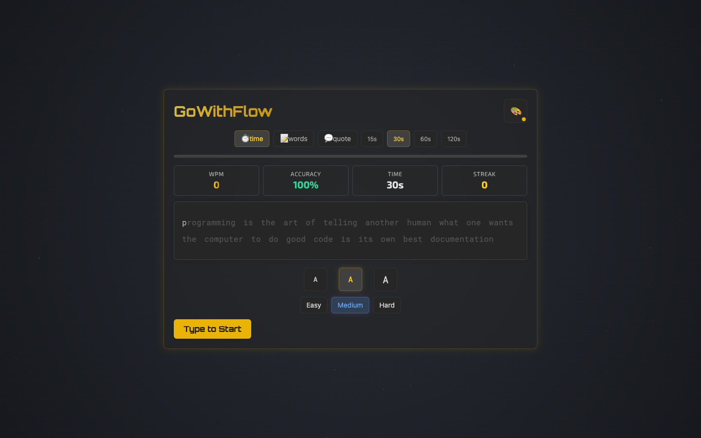
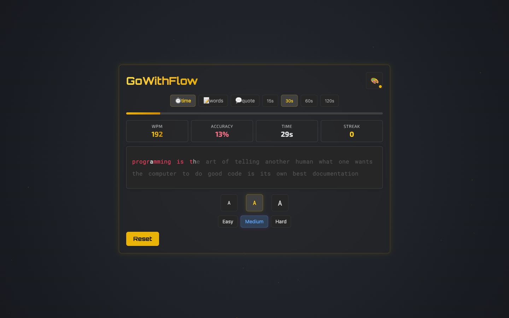

# GoWithFlow — Typing Speed Test

<div align="center">

    

</div>

A sleek, minimal typing speed test single page application built with Next.js, TypeScript, and Tailwind CSS. Measure your WPM, accuracy, and streak across timed modes, word counts, and quotes — with multiple fonts, themes, and difficulty levels.

## Features

- **Three test modes**: timed (15s / 30s / 60s / 120s), word count, and quotes
- **Live stats HUD**: WPM, accuracy, time remaining, and keystroke streak
- **Difficulty levels** with distinct word pools
- **Multiple monospace fonts**: Roboto Mono, JetBrains Mono, Fira Code (via `next/font`)
- **Theme & font size switching** for a personalized typing surface
- **Detailed results screen** with per-test statistics
- **Keyboard-first UX** — just start typing

## Tech Stack

| Layer | Technology |
|---|---|
| Framework | Next.js 14 (Pages Router) |
| Language | TypeScript |
| Styling | Tailwind CSS + styled-jsx |
| Fonts | next/font/google |
| Effects | canvas-confetti |

## 📸 Screenshots

### Test Arena



### Live Typing — WPM & Accuracy HUD



## Getting Started

### Prerequisites

- Node.js 18+
- npm

### Installation

```bash
git clone https://github.com/iabhishek18/typewriter.git
cd typewriter
npm install
```

### Development

```bash
npm run dev
```

Open [http://localhost:3000](http://localhost:3000) and start typing.

### Production Build

```bash
npm run build
npm start
```

## Project Structure

```
├── pages/
│   ├── _app.tsx        # App wrapper, global styles
│   ├── _document.tsx   # HTML document shell
│   └── index.tsx       # Typing test engine, UI, and stats
├── public/             # Static assets
├── styles/
│   └── globals.css     # Tailwind directives
├── next.config.mjs
├── tailwind.config.ts
└── tsconfig.json
```

## How It Works

The test engine tracks each keystroke against the target text, computing gross/net WPM and accuracy in real time. Mode, duration, difficulty, font, and theme are all local state — switching any of them resets the test instantly without a page reload.

## License

MIT
